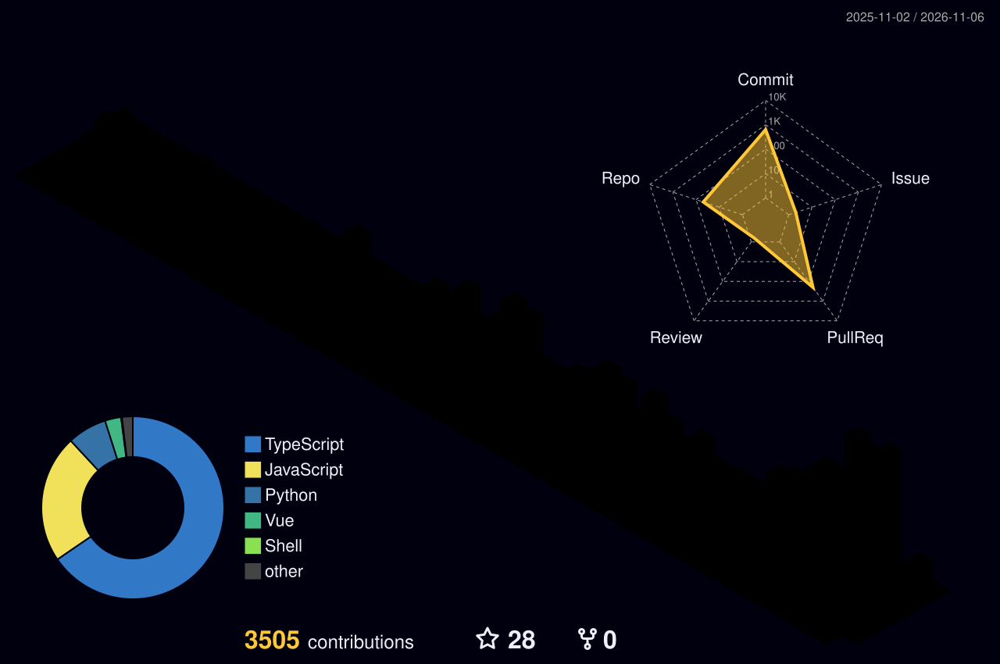

<!-- FILE: .github/profile/README.md | USER HANDLE: DonArtkins -->

<!-- ═══════════════════════════════════════════════════════
     HEADER
═══════════════════════════════════════════════════════ -->
<div align="center">


<br/><br/>

<a href="https://git.io/typing-svg">
  
</a>

<br/><br/>

<!-- ═══════════════════════════════════════════════════════
     BADGES
═══════════════════════════════════════════════════════ -->

[](https://lyncxs.com)
[](https://linkedin.com/in/donartkins)
[](https://twitter.com/donartkins)
[](mailto:don@lyncxs.com)

</div>

<!-- ═══════════════════════════════════════════════════════
     ABOUT
═══════════════════════════════════════════════════════ -->


### <svg width="32" height="32" viewBox="0 0 24 24" fill="none" xmlns="http://www.w3.org/2000/svg"><circle cx="12" cy="8" r="4" fill="#6366F1"/><path d="M4 20c0-4.4 3.6-8 8-8s8 3.6 8 8" stroke="#6366F1" stroke-width="2" stroke-linecap="round"/></svg> About Me

```typescript
const donArtkins = {
    location: "Kenya",
    role: "Software Engineer & Architect",
    company: "Lyncxs Industries",
    
    focus: [
        "Premium software development",
        "AI & machine learning",
        "Mobile applications",
        "Open source tools"
    ],
    
    philosophy: {
        quality: "Premium standards in every project",
        openSource: "Tools should be free & accessible",
        africa: "Solutions built for African context"
    }
};
```

<br clear="right"/>

<!-- ═══════════════════════════════════════════════════════
     TECH STACK
═══════════════════════════════════════════════════════ -->

---

### <svg width="32" height="32" viewBox="0 0 24 24" fill="none" xmlns="http://www.w3.org/2000/svg"><path d="M20 7h-4V4c0-1.1-.9-2-2-2h-4c-1.1 0-2 .9-2 2v3H4c-1.1 0-2 .9-2 2v11c0 1.1.9 2 2 2h16c1.1 0 2-.9 2-2V9c0-1.1-.9-2-2-2zM10 4h4v3h-4V4z" fill="#6366F1"/></svg> Tech Stack

<div align="center">

#### Languages


#### Frontend


#### Backend


#### AI & ML


#### DevOps & Tools


</div>

<!-- ═══════════════════════════════════════════════════════
     STATISTICS
═══════════════════════════════════════════════════════ -->

---

### <svg width="32" height="32" viewBox="0 0 24 24" fill="none" xmlns="http://www.w3.org/2000/svg"><path d="M3 13h8V3H3v10zm0 8h8v-6H3v6zm10 0h8V11h-8v10zm0-18v6h8V3h-8z" fill="#6366F1"/></svg> GitHub Statistics

<div align="center">


  
<table>
<tr>
<td width="50%">


</td>
<td width="50%">


</td>
</tr>
</table>

<br clear="right"/>


<br/>


</div>

<!-- ═══════════════════════════════════════════════════════
     TROPHIES
═══════════════════════════════════════════════════════ -->

---

### <svg width="32" height="32" viewBox="0 0 24 24" fill="none" xmlns="http://www.w3.org/2000/svg"><path d="M19 5h-2V3H7v2H5c-1.1 0-2 .9-2 2v1c0 2.55 1.92 4.63 4.39 4.94.63 1.5 1.98 2.63 3.61 2.96V19H7v2h10v-2h-4v-3.1c1.63-.33 2.98-1.46 3.61-2.96C19.08 12.63 21 10.55 21 8V7c0-1.1-.9-2-2-2zM5 8V7h2v3.82C5.84 10.4 5 9.3 5 8zm14 0c0 1.3-.84 2.4-2 2.82V7h2v1z" fill="#F59E0B"/></svg> GitHub Trophies

<div align="center">


  
  
<br clear="right"/>
  
</div>

<!-- ═══════════════════════════════════════════════════════
     ACTIVITY GRAPH
═══════════════════════════════════════════════════════ -->

---

### <svg width="32" height="32" viewBox="0 0 24 24" fill="none" xmlns="http://www.w3.org/2000/svg"><path d="M4 18h2.5l-3 3-3-3H3v-4c0-.55.45-1 1-1s1 .45 1 1v4zm15-8h-2.5l3-3 3 3H21v4c0 .55-.45 1-1 1s-1-.45-1-1v-4z" fill="#6366F1"/><path d="M9 10c0 1.66-1.34 3-3 3s-3-1.34-3-3 1.34-3 3-3 3 1.34 3 3zm11 0c0 1.66-1.34 3-3 3s-3-1.34-3-3 1.34-3 3-3 3 1.34 3 3z" fill="#6366F1"/><path d="M15 17H9v-2h6v2z" fill="#6366F1"/></svg> Contribution Activity

<div align="center">
  
[](https://github.com/DonArtkins)

</div>

<!-- ═══════════════════════════════════════════════════════
     SNAKE ANIMATION
═══════════════════════════════════════════════════════ -->

---

### <svg width="32" height="32" viewBox="0 0 24 24" fill="none" xmlns="http://www.w3.org/2000/svg"><rect x="2" y="16" width="4" height="6" rx="1" fill="#22C55E"/><rect x="7" y="12" width="4" height="10" rx="1" fill="#6366F1"/><rect x="12" y="8" width="4" height="14" rx="1" fill="#F59E0B"/><rect x="17" y="4" width="4" height="18" rx="1" fill="#EC4899"/></svg> Contribution Graph

<div align="center">

<picture>
  <source media="(prefers-color-scheme: dark)" srcset="https://raw.githubusercontent.com/DonArtkins/DonArtkins/output/github-contribution-grid-snake-dark.svg">
  <source media="(prefers-color-scheme: light)" srcset="https://raw.githubusercontent.com/DonArtkins/DonArtkins/output/github-contribution-grid-snake.svg">
  
</picture>

</div>

<!-- ═══════════════════════════════════════════════════════
     3D CONTRIBUTION
═══════════════════════════════════════════════════════ -->

---

### <svg width="32" height="32" viewBox="0 0 24 24" fill="none" xmlns="http://www.w3.org/2000/svg"><path d="M21.41 11.58l-9-9C12.05 2.22 11.55 2 11 2H4c-1.1 0-2 .9-2 2v7c0 .55.22 1.05.59 1.42l9 9c.36.36.86.58 1.41.58s1.05-.22 1.41-.59l7-7c.37-.36.59-.86.59-1.41s-.23-1.06-.59-1.42zM5.5 7C4.67 7 4 6.33 4 5.5S4.67 4 5.5 4 7 4.67 7 5.5 6.33 7 5.5 7z" fill="#6366F1"/></svg> 3D Contribution Calendar

<div align="center">


  
  
<br clear="right"/>
  
</div>

<!-- ═══════════════════════════════════════════════════════
     WHAT I DO
═══════════════════════════════════════════════════════ -->

---

### <svg width="32" height="32" viewBox="0 0 24 24" fill="none" xmlns="http://www.w3.org/2000/svg"><path d="M20 6h-3V4c0-1.1-.9-2-2-2H9c-1.1 0-2 .9-2 2v2H4c-1.1 0-2 .9-2 2v11c0 1.1.9 2 2 2h16c1.1 0 2-.9 2-2V8c0-1.1-.9-2-2-2zM9 4h6v2H9V4zm3 12l-4-4h3V9h2v3h3l-4 4z" fill="#6366F1"/></svg> What I Do

- <svg width="16" height="16" viewBox="0 0 24 24" fill="none" xmlns="http://www.w3.org/2000/svg"><path d="M12 2L2 7v10c0 5.55 3.84 10.74 9 12 5.16-1.26 9-6.45 9-12V7l-10-5zm0 19.93c-4.24-1.15-7-5.46-7-9.93V8.63l7-3.93 7 3.93V12c0 4.47-2.76 8.78-7 9.93z" fill="#F59E0B"/></svg> Build premium software solutions
- <svg width="16" height="16" viewBox="0 0 24 24" fill="none" xmlns="http://www.w3.org/2000/svg"><circle cx="12" cy="12" r="3" fill="#6366F1"/><path d="M12 2l2 7h7l-5.5 4.5L18 21l-6-4.5L6 21l2.5-7.5L3 9h7l2-7z" fill="#6366F1"/></svg> Develop AI-powered applications
- <svg width="16" height="16" viewBox="0 0 24 24" fill="none" xmlns="http://www.w3.org/2000/svg"><rect x="5" y="2" width="14" height="20" rx="2" fill="none" stroke="#22C55E" stroke-width="2"/><path d="M12 18h.01" stroke="#22C55E" stroke-width="2"/></svg> Create mobile apps with React Native
- <svg width="16" height="16" viewBox="0 0 24 24" fill="none" xmlns="http://www.w3.org/2000/svg"><path d="M20 7h-4V4c0-1.1-.9-2-2-2h-4c-1.1 0-2 .9-2 2v3H4c-1.1 0-2 .9-2 2v11c0 1.1.9 2 2 2h16c1.1 0 2-.9 2-2V9c0-1.1-.9-2-2-2zM10 4h4v3h-4V4z" fill="#EC4899"/></svg> Maintain open source developer tools
- <svg width="16" height="16" viewBox="0 0 24 24" fill="none" xmlns="http://www.w3.org/2000/svg"><path d="M3 3h18v18H3z" fill="none" stroke="#8B5CF6" stroke-width="2"/><path d="M8 8h8M8 12h8M8 16h5" stroke="#8B5CF6" stroke-width="2"/></svg> Architect scalable systems
- <svg width="16" height="16" viewBox="0 0 24 24" fill="none" xmlns="http://www.w3.org/2000/svg"><circle cx="12" cy="12" r="10" fill="none" stroke="#10B981" stroke-width="2"/><path d="M12 2v20M2 12h20" stroke="#10B981" stroke-width="2"/></svg> Solve problems for African markets

<!-- ═══════════════════════════════════════════════════════
     CORE VALUES
═══════════════════════════════════════════════════════ -->

---

### <svg width="32" height="32" viewBox="0 0 24 24" fill="none" xmlns="http://www.w3.org/2000/svg"><path d="M12 2l2.4 7.4h7.6l-6 4.6 2.3 7-6.3-4.6-6.3 4.6 2.3-7-6-4.6h7.6L12 2z" fill="#F59E0B"/></svg> Core Values

<table align="center">
<tr>
<td align="center" width="33%">

#### <svg width="24" height="24" viewBox="0 0 24 24" fill="none" xmlns="http://www.w3.org/2000/svg"><path d="M12 2L2 7v10c0 5.55 3.84 10.74 9 12 5.16-1.26 9-6.45 9-12V7l-10-5z" fill="#6366F1"/></svg> Quality First
Premium standards in everything I build

</td>
<td align="center" width="33%">

#### <svg width="24" height="24" viewBox="0 0 24 24" fill="none" xmlns="http://www.w3.org/2000/svg"><path d="M18 8h-1V6c0-2.76-2.24-5-5-5S7 3.24 7 6v2H6c-1.1 0-2 .9-2 2v10c0 1.1.9 2 2 2h12c1.1 0 2-.9 2-2V10c0-1.1-.9-2-2-2zM9 6c0-1.66 1.34-3 3-3s3 1.34 3 3v2H9V6zm9 14H6V10h12v10zm-6-3c1.1 0 2-.9 2-2s-.9-2-2-2-2 .9-2 2 .9 2 2 2z" fill="#10B981"/></svg> Open Source
Tools & frameworks freely available

</td>
<td align="center" width="33%">

#### <svg width="24" height="24" viewBox="0 0 24 24" fill="none" xmlns="http://www.w3.org/2000/svg"><circle cx="12" cy="12" r="10" fill="none" stroke="#F59E0B" stroke-width="2"/><path d="M12 2v20M2 12h20" stroke="#F59E0B" stroke-width="2"/></svg> Africa-Focused
Solutions that work in African context

</td>
</tr>
</table>

<!-- ═══════════════════════════════════════════════════════
     CONNECT
═══════════════════════════════════════════════════════ -->

---

### <svg width="32" height="32" viewBox="0 0 24 24" fill="none" xmlns="http://www.w3.org/2000/svg"><path d="M20 2H4c-1.1 0-2 .9-2 2v18l4-4h14c1.1 0 2-.9 2-2V4c0-1.1-.9-2-2-2z" fill="#6366F1"/></svg> Let's Connect

<div align="center">

[](https://github.com/DonArtkins)
[](https://linkedin.com/in/donartkins)
[](https://twitter.com/donartkins)
[](https://lyncxs.com)
[](mailto:don@lyncxs.com)

</div>

---

<div align="center">

### <svg width="24" height="24" viewBox="0 0 24 24" fill="none" xmlns="http://www.w3.org/2000/svg"><path d="M9 2L7 12h4l-2 10 10-14h-5l2-6z" fill="#F59E0B"/></svg> "Quality code, innovative solutions, African impact"


</div>

<!-- ═══════════════════════════════════════════════════════
     FOOTER
═══════════════════════════════════════════════════════ -->


